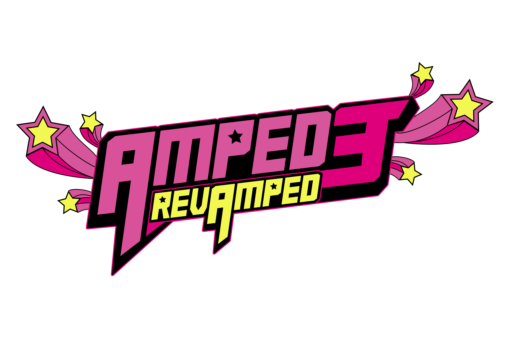

# Amped 3 Revamped

This is a recompilation of Amped 3 that has made use of ReXGlue and Claude to port the Xbox 360 code to modern platforms.

Features:
 - High resolution support, with display output settings, render resolution slider, XeSS and FSR options for upscaling the graphics.
 - Enhanced visuals, including camera and object-based motion blur (toggleable with intensity slider), speed blur, atmospheric fog, crepuscular sun rays, and a fog animation when entering and leaving the Trail Map.
 - EXPERIMENTAL high framerate support with some fixes for various minigames, this is still being worked on against a full playthrough of the game and all activities. Supports 30, 40, 60, 90, 120 and unlocked frame rates.
 - Modern Controller Support via xinput or SDL.
 - An in-game options menu that's controller navigable. F1 still works to access every option, as well as F4 for debug options.

What's been tested:
 - Northstar and Snowbird have been extensively tested, but I've yet to have tried the other parts of the game. Amped 3 Revamped includes a level and cutscene menu to replay completed story missions and cutscenes, as well as any that haven't been unlocked through normal gameplay.
 - It runs well on my Intel i7 358H laptop with 32gb of ram, around 60fps at a 50% resolution scale at 1080p or at 1440p with XESS.
 - The game runs via proton in SteamOS on a Ryzen 7700, 9070xt machine well, and less well but still functional on an Ayn Odin 3 running Armada.

WIP Features:
  - A texture upscaling system that runs on the host's device, allowing for higher resolution assets. I'm working on manually recreating the fonts and have remade the title logo at a higher resolution.
  - High framerate support is mostly working, but some side missions have had issues. The injury minigame has a scoring fix in place, as does turning of sleds and the hangglider at higher resolutions matching the turn speed of the standard game. 30 fps is consistent.
  - An x86/ARM Linux port, as I would like to test on a SteamOS desktop and on Armada on an AYN Odin 3. Proton works for both of these devices, but less translation would be preferable.
  - It seems like the launch Xbox 360 games might be single-threaded? Going to investigate further and see if multi-threading can be enabled to improve performance even further.

# Claude generated output below...

Amped 3 (Xbox 360), running natively on Windows, with a new renderer and
enhancements.

This project statically recompiles Amped 3's `default.xex` into C++ with the
[ReXGlue SDK](https://github.com/rexglue/rexglue-sdk) and builds a Windows
executable. On top of the plain recompile it adds:

- **Controller support.** SDL3 drives Xbox, PlayStation, Switch Pro and most
  other controllers, with hot-plugging. XInput is available as an alternative,
  and keyboard and mouse can stand in for a pad.
- **An in-game options menu** that you can drive entirely with a controller
  (**Back + Start**, or **F1**):
  - **Display:** fullscreen, output resolution (up to 4K), 16:9 letterbox,
    frame rate limit (Auto: 60 with Revamped Graphics and 30 without; 30 console
    pacing, 40 to 144, or unlocked), render scale (1–3×),
    integer scaling, CAS/FSR upscaling and sharpening.
  - **Graphics:** anisotropic filtering (up to 16×), background shader
    compilation, GPU readback accuracy.
  - **Audio:** mute, stereo mix, buffer size, subtitles (see *Subtitles*).
  - **Controls:** controller driver, Guide button passthrough, keyboard/mouse mode
    and sensitivity.
  - **Enhancements:** game patch toggles (see *Adding an enhancement*) and
    experimental refresh-rate and frame-pacing controls.
  - **Cutscenes:** play, restart or skip any story cutscene while riding (for
    testing cutscene fixes).
  - **Challenges:** every challenge and story mission the game knows, by
    mountain; start any of the loaded mountain's (story missions already
    played included).

  Changes save to `amped3.toml` next to the exe. Settings that only apply after
  a relaunch are marked *(restart)*, and the menu lists any that are waiting.
  The menu only shows settings your SDK build actually has. While it is open,
  the game sees an idle controller.

## Patch notes

### 2026-10-22: experimental merged into main

**Launcher (v0.2.2)**
- New program that installs, updates and starts the game from one download
  (Windows, Linux x86_64, Linux arm64), driven by controller, keyboard or mouse.
- Animated Amped 3 Revamped logo as the title (plays once, holds its last frame).
- Desktop shortcut / Steam entry uses the game's own Xbox 360 dashboard icon,
  taken from your `default.xex` at install (made on the spot for older installs).

**Performance (native renderer)**
- Draw recording moved off the game thread, with fewer locks, allocations and
  clock reads per draw; Direct3D's draw and state packets skipped while the
  emulation doesn't draw.
- Renderer: Vulkan commands recorded on their own thread, fewer render passes,
  texture descriptor sets kept between frames, depth pre-pass at the scene's
  resolution with an upscaler.
- Linux: the audio worker and command processor no longer spin (SDK patches
  0023, 0024); input polling no longer re-enumerates devices (0025).
- Armada (AYN Odin 3): riding went from about 60 to 100+ fps.

**Fixes**
- In-game challenge videos no longer freeze or pop at the start on Armada.
- Map clouds no longer drop the frame rate to ~10 fps.
- Only one copy of the game runs at a time (a second launch no longer plays
  menu music over the game).

**Graphics**
- FSR 3.1 on Linux (built from AMD's FidelityFX sources by setup.sh).
- MSAA off now keeps the multisampled look (the game's per-sample lighting and
  see-through foliage are reproduced). With FSR or XeSS, MSAA is off by default
  and has its own setting, MSAA with the upscaler.
- FSR: snow and other particles no longer leave trails (reactive mask).
- Sharp Fonts and Upscaled Textures are opt-in, separate from Revamped Graphics.

**Diagnostics**
- F11 performance trace: per-zone times, per-thread CPU, kernel share and page
  faults, GPU time by part, and the command stream; a stall watch in the log.

## Folders

Nothing needs a particular name or place. The project folder can be called
anything, anywhere:

```
<project>\                 ← this project (unzip it anywhere)
├── Install Amped 3 Revamped.bat
├── <any folder>\          ← your extracted game, if you build without the installer
└── out\, logs\            ← created by the build
<project>\..\rexglue-sdk\  ← the SDK, created by setup.ps1 (or -SdkDir <folder>)
```

`setup.ps1` finds the extracted game by looking for `default.xex` in the
folders inside the project, then the folders next to it; pass `-GameDir
"<folder with default.xex>"` to name it directly.

The installed game is one portable folder; move it anywhere:

```
<install folder>\
├── amped3.exe, *.dll
├── amped3-launcher.exe ← the launcher (installs from the launcher)
├── build\            ← the sources and build (installs from the launcher)
├── amped3.toml       ← settings
├── game\             ← the game's files (from your disc)
├── save\             ← saves and profile
├── cache\            ← shader storage (safe to delete)
├── textures\         ← texture pack and upscaled textures
└── logs\
```

Saves used to go to `Documents\amped3`; the first start of this version copies
them into `save\` (the old folder is left as a backup). `--user_data_root`,
`--cache_root` and `--game_data_root` still point elsewhere if you want.

## Requirements

- Windows 10/11 x64.
- **Visual Studio 2022 or newer** (Community is fine), with the
  *Desktop development with C++* workload and these individual components:
  *C++ Clang Compiler for Windows* and *MSBuild support for LLVM (clang-cl)
  toolset*. CMake and Ninja come with it.
- **Clang 20 or newer.** If Visual Studio's bundled Clang is older,
  `winget install LLVM.LLVM` works too, and the script finds either one.
- **Git:** `winget install Git.Git`.
- Optional: turn on **Developer Mode** (Settings → System → For developers) so
  the SDK's symlinks check out properly. The script works around them if it's off.

## Install with the launcher (easiest)

Download the launcher for your system from the
[Releases](https://github.com/minty-hippo/amped3revamped/releases) page and run
it:

| System | File |
|---|---|
| Windows | `amped3-launcher-windows-x64.exe` |
| Linux, SteamOS (x86_64) | `amped3-launcher-linux-x86_64` |
| Armada and other ARM handhelds (arm64) | `amped3-launcher-linux-arm64` |

The launcher contains nothing from the game. It downloads this project's
sources from GitHub and builds the game on your computer from your own Amped 3
(USA) disc image (`.iso`, a redump/XGD2 rip).

**First run:**

1. Pick the disc image. The launcher lists the `.iso` files it finds in your
   home, Downloads, Documents and Desktop folders and on removable drives;
   select the row to browse for another one.
2. Pick the branch: `main`, or `experimental` for the newest work.
3. Check the install folder (default `Games/Amped3Revamped` in your user
   folder). You need about 40 GB free. Everything goes there: the game, its
   build (`build/amped3revamped`) and the launcher itself.
4. Choose the **Graphics**: Revamped (the new effects and 60 fps; the
   default) or Original (as on the Xbox 360), and whether to **Upscale
   textures** (menus, HUD and loading screens 4x with Real-ESRGAN after the
   build; Windows and Linux x86_64), and whether to make **Subtitles** after
   the build (see *Subtitles*). These can be changed later: Graphics
   settings, and Upscale textures and Make subtitles on the launcher's home
   page.
5. Select **Build and install** (twice, to confirm). The build's output
   scrolls in the launcher and is saved to a log. The first build takes about
   an hour on a PC and several hours on a handheld.
6. Once installed, the launcher moves itself into the install folder as
   `amped3-launcher(.exe)`, so nothing is left in Downloads; a newer launcher
   you download later takes its place the first time you run it.

Under the hood it runs the same installers as the manual routes below:
`Install-Amped3.ps1` on Windows (it offers to install the build tools with
winget), and `install.sh` on Linux (in a podman container on SteamOS and
Armada).

**Afterwards** the launcher opens on:

- **Play.**
- **Update branch / Update:** gets the chosen branch and rebuilds. The status
  says whether there's anything new.
- **Check for updates:** lists the changes on the branch since your install.
- **Graphics settings:** the in-game Graphics panel's settings (display:
  fullscreen, frame rate, resolutions, upscaler, MSAA with the upscaler,
  shadow resolution and distance,
  sharp fonts, upscaled textures; effects: Revamped Graphics and its parts),
  saved to the install's `amped3.toml` for the next start. New installs start
  fullscreen.
- **Upscale textures:** runs the texture upscaler (Real-ESRGAN, 4x: menus,
  HUD and loading screens) and switches Upscaled textures on. Windows and
  Linux x86_64.
- **Subtitles:** the subtitle settings (show them, speaker colours, text
  size), **Make subtitles** (see *Subtitles*; stopping it is fine, running it
  again carries on) and **Edit subtitles**, the subtitle editor.
- **Start the game directly:** the launcher starts the game at once next
  time. Hold LB / View on a controller, or Shift, while it starts to see the
  launcher.
- **Desktop shortcut** (Windows) or **Add to Steam / menu** (Linux): points
  at `amped3-launcher` in the install folder. Its icon is the game's own square
  Xbox 360 dashboard logo, taken at install from your `default.xex` by
  `amped3-icon` (`tools/xex-icon`) into `amped3-icon.ico` / `amped3-icon.png`
  in the install folder; nothing of the game ships with the project.
- The installed version (branch, commit and date) is under the title.

It works with a controller (d-pad or stick, A), the keyboard (arrows, Enter)
and the mouse, and opens full screen in Steam's Game Mode. Its settings are in
`%APPDATA%\Amped3Revamped\launcher.ini` (Windows) or
`~/.config/amped3-revamped/launcher.ini` (Linux), with the logs of each
install or update beside them.

To build the launcher yourself: `cmake -S launcher -B out/launcher` and
`cmake --build out/launcher --config Release` (it fetches SDL3 and Dear ImGui). A
new release: raise `launcher/VERSION` on main; the Launcher workflow builds the
three files and publishes them.

## Install from the ISO with the scripts

Double-click **`Install Amped 3 Revamped.bat`** in the project folder. It will:

1. Ask for your Amped 3 (USA) disc image (`.iso`, a redump/XGD2 rip) and an
   install folder. The default is `Games\Amped 3 Revamped` in your user folder, and you need
   about 40 GB free.
2. Install anything missing with winget: VS 2022 Build Tools with the C++ and
   Clang components, LLVM, and Git. Pass `-NoToolInstall` to skip this.
3. Extract the game from the ISO into `<install folder>\game` and check its
   title ID. Nothing else is needed to read the ISO.
4. Run `setup.ps1` to build. The first time takes a long while.
5. Copy `amped3.exe`, its DLLs and `amped3.toml` into the install folder. This
   gives you a portable, self-contained folder you can move anywhere, and it
   can make a desktop shortcut.

Options (run from PowerShell, or append them to the .bat):

- `-Iso <path>`
- `-InstallDir <path>`
- `-GameDir <already-extracted folder>`
- `-Config RelWithDebInfo`
- `-ReExtract`
- `-Yes` (no prompts)
- `-Run`

Logs go to `logs\install-*.log`. Running it again skips the extraction and
rebuilds only what changed.

## Linux: SteamOS, Armada and other distributions (experimental)

The same port builds for Linux on x86_64 (Steam Deck / SteamOS, desktop
distributions) and aarch64 (Armada and other Snapdragon handhelds), drawing
with Vulkan. In a terminal (Desktop Mode on a handheld), in the project folder:

```sh
bash install.sh --iso "/path/to/Amped 3.iso"
```

It extracts the game (`linux/xiso.py`, plain Python), builds, and puts a
portable folder together (default `~/Games/Amped 3 Revamped`) with
`amped3-revamped.sh` and a desktop entry; on SteamOS it offers to add the game
to Steam (elsewhere: Steam > Games > Add a Non-Steam Game). Game Mode,
Steam Input and the Deck's controls work as an Xbox controller.

- **No build tools needed on SteamOS / Armada.** Their system is read-only, so
  `install.sh` builds inside a container (`linux/Containerfile`: Ubuntu 24.04
  with Clang 20) with the podman both include; nothing is installed on the
  system. With Clang 20+, CMake, Ninja and the X11 / Wayland / audio
  development packages installed, it builds natively (`--native`), or run
  `./setup.sh` directly.
- **Build on the device itself.** It takes hours on a handheld the first time
  (the recompiled game is large) and about 40 GB; jobs are limited by memory
  (about one per 2.5 GB). Builds are per architecture: build the ARM version on
  the ARM device.
- **AMD FSR 3.1 on Linux** is built from AMD's FidelityFX SDK sources (MIT):
  AMD ships its runtime for Windows only, so `setup.sh` takes the needed
  folders of the SDK (v1.1.4, a 25 MB sparse clone), applies
  `linux/fidelityfx/fidelityfx-sdk-linux.patch` (the SDK's shader compiler
  ported to Linux, plus fixes for Clang/GCC and for GPUs whose memory is all
  host-visible, as on ARM), compiles the FSR shaders and builds
  `libamd_fidelityfx_vk.so` next to the game: about two minutes, once. If it
  fails the game still works with the Upscaler off.
- **Not on Linux:** Intel XeSS (Intel's XeSS SDK has Windows libraries only;
  the render scale still works, stretched, or use FSR 3.1) and the F9 hang
  report. Crashes are written to `logs/amped3_crash_*.txt`.
- **Texture upscaling** (`linux/upscale-textures.sh`, or the installer's
  question) uses Real-ESRGAN's official Linux build, x86_64 only; on ARM pass
  `--esrgan` with a build of
  [Real-ESRGAN-ncnn-vulkan](https://github.com/xinntao/Real-ESRGAN-ncnn-vulkan).

## Build

From a normal PowerShell window in the project folder:

```powershell
powershell -ExecutionPolicy Bypass -File .\setup.ps1 -Run
```

The script checks your tools and clones the ReXGlue SDK at a pinned commit. It
applies the SDK fixes in `patches\rexglue`, builds and installs the SDK,
runs `rexglue init` against your game, and builds `out\build\win-amd64-release\amped3.exe`.

- The first run is long. The SDK takes a while to build. The recompiler then
  writes a few hundred MB of C++ to `generated\default\`, and compiling that
  is the slowest part.
- Rebuild later: `.\setup.ps1 -SkipSdk`
- Get past startup crashes: `.\setup.ps1 -SkipSdk -FixCrashes`. This launches the game, and whenever it crashes with *Call to invalid or unregistered function*, registers that address and rebuilds. It repeats until the game survives 45 seconds.
- Debuggable build for crashes: `.\setup.ps1 -SkipSdk -Config RelWithDebInfo`
- Game somewhere else: `.\setup.ps1 -GameDir "<folder with default.xex>"`

The exe uses the `game\` folder next to it. The build folder has none, so
`setup.ps1 -Run` (and `-FixCrashes`) start it with `--game_data_root` pointing
at the extracted game; the installer puts a `game\` folder in the install.

## Graphics

The game is drawn by the port's own Vulkan renderer (on by default; Options
(F1) > Graphics > Native renderer switches back to the GPU emulation).

Quality (Options > Graphics > Quality, or the graphics panel's Quality
tab): a preset (Low, Medium, High, Ultra) and a level for each part of the
lighting, each setting the detailed options under it:

| Part | Levels |
|---|---|
| Sun shadows | Game's (its painted shadows) / Low / Medium / High (world shadows 2x-4x, sharper, farther) |
| Lamp shadows | Off / Low (two nearest lamps) / Medium (every lamp) / High (every lamp, finer) |
| Atmosphere | Fog / God rays / Volumetric low (quarter size) / high (half) / ultra (finer steps) |
| Ambient occlusion | Off / On |
| Surface detail | Low / High (settling snow, snow tracks, cloud shadows, sun sheen, drifting snow) |

The detailed options stay adjustable; a part whose options match none of
its levels shows Custom, and so does the preset. High is the default.

The GPU emulation keeps running underneath (the game waits on it every
frame) but stops drawing. When the native renderer is on at launch, the
emulation also starts lean: it doesn't load its shader cache and ignores
the resolution scale, for a faster start and less memory. Switching to the
emulation mid-game still works (shaders compile as it goes, at 1x); restart
for the full setup, or turn off **Lean emulation** (`emulated_gpu_lean`) if
you switch often.

**Revamped Graphics** turns all the visual enhancements on or off at once:
motion blur, speed blur, ambient occlusion, distance fog, god rays, branch
fade and the trail map clouds. Each keeps its own setting for when the switch is back on. Sharp
fonts and upscaled textures aren't part of it: they're off until you turn them
on yourself.

All of it is also in the game's own menu: **Pause > Options > Graphics** (the
row that was the unused "Cheat Codes") opens the port's Graphics panel. The
game's HUD and menus are hidden while it's open so you can see each change.
It has two tabs, switched with LB / RB:

- **Effects:** Revamped Graphics, a switch for each enhancement and the
  motion blur strength.
- **Display:** fullscreen, a frame rate slider (30 console pacing to 144 fps, or
  unlocked), display resolution, render resolution (with the
  pixel size it gives), upscaler (Intel XeSS or AMD FSR 3.1; FSR 3.1 only on
  Linux), FSR sharpness, and Sharp Fonts and Upscaled Textures (both off by
  default).

Up / down choose, left / right / A change, B goes back (keyboard: arrows,
Enter, Escape, Q / E for tabs).

**Sharp fonts.** The game's fonts are small bitmaps made for 720p, so at
higher resolutions its text is stretched and soft. The native renderer
rebuilds each of the five fonts (button icons included) at 4x from its own
letters the first time it's shown: each glyph's outline is traced into a
vector shape (straight edges, sharp corners, curves where the letter curves)
and filled anti-aliased at the new size. The result is kept in `logs\`
(`native_font_*.bin`) so later sessions load it at once; nothing is shipped. It's
off by default: turn it on with Sharp Fonts (Graphics panel, Display tab) or
`native_sharp_fonts = true`.

**Texture pack.** PNGs in the `textures` folder next to the exe replace game
textures by a hash of their contents, at any size (see
`assets/textures/README.txt`). Your own replacements go in
`assets/local/textures` (copied next to the exe by the build; kept out of the
published sources), for example a new logo for the start-up loading screen
and the title screen, made from `assets/local/amped3_logo.png` by
`tools/textures/make_logo_textures.py`. `native_texture_pack = false` turns
the pack off.

To draw the fonts by hand, `tools/textures/font_templates.py --game <game
folder> --out <folder>` writes each font's original image, a 4x guide (glyph
boxes, characters, baselines), a map (CSV) and the file name to save the
drawing under.

**Upscaled textures (optional).** The installer offers to upscale the game's
menu, HUD and loading screen textures 4x on your PC with
[Real-ESRGAN](https://github.com/xinntao/Real-ESRGAN) (ncnn/Vulkan build, any
GPU; downloaded once, 45 MB). `Upscale Textures.bat` runs the same step any
time (`-Set world` adds the characters, boards and levels, experimental;
`-Force` redoes everything). The results go to `textures\upscaled` and are
used only where neither the texture pack nor Sharp fonts replace a texture,
so anything you replace by hand always wins. Every result is checked against
the original texture: on some GPUs (seen on Intel Arc) Real-ESRGAN returns
garbled patches (holes, missing pieces of icons), which are mended with a
plain smooth upscale, and a texture that comes out mostly garbled is left out.
Running the step again checks and mends earlier results too. The installer
switches Upscaled Textures on after upscaling; turn them off or on with
Upscaled Textures (Graphics panel, Display tab) or
`native_upscaled_textures`.

The row is added in memory as the game loads its menus; the game's files are
never changed. Set `patch_game_menus = false` in `amped3.toml` to leave the
menus untouched.

### Dynamic time of day (experimental)

Off by default; F5, or Graphics panel > Time of Day, or `native_time_of_day`
turns it on. The sun and moon move across the sky, and the mountain's light
follows the hour: low warm sun at dawn and dusk, blue twilight, a moonlit
night with stars, and clouds drifting overhead. Each mountain starts at the
hour it was made for, where it looks as the game has it; every other hour is
worked out from that, so it fits each mountain's own look.

Northstar keeps its own hour until the Night Pass is earned (Time of Day:
Northstar Waits for the Night Pass, `native_tod_night_pass_lock`, on by
default). Earned is read from the game's challenges (a Northstar challenge
named for the night pass done, or one named for the night unlocked) and
remembered in `lights\night_pass.txt`; deleting that file forgets it. Each
time Northstar loads, its challenges and their states go to the log, to check
that rule against a save that has the pass.

- The terrain (the game's deferred lighting pass), and riders, characters
  and props (their own lighting constants, found by their values) all take
  the hour's sun or moon direction, its color and the sky's light.
- The sky: the game's painted panorama recolored for the hour (its painted sun
  dimmed once the real one has moved away), drifting clouds, the sun's disc,
  the moon's disc lit from the sun's side (its phase), stars at night. The
  distance fog and god rays take their colors from it.
- Weather (Time of Day: Weather, `native_weather`; Changing by default):
  spells of a few minutes (`native_weather_minutes`) easing one into the
  next: clear; overcast (a grey sky: the sun's light mostly gone, the light
  soft and all round, shadows faint, the game's painted shadows faded, the
  sky and stars hidden); snowing (flakes falling through the scene, hidden
  behind what's in front of them, lit by the sky and by the night lights
  near them); and now and then a blizzard (strong wind streaking the snow
  sideways, the fog closing in to a few dozen metres). Or one of them fixed.
  As the weather turns it's announced in the game's own song popup (the XM
  Radio box: "Weather Alert / Gusts 55 km/h / Whiteout"), with a forecast a
  minute ahead ("Forecast / Snow on the way / Next hour"), or a notice where
  there's no popup (F5 on a mountain shows the weather in it too); the clouds drift faster in the wind; in a heavy snowstorm the
  night lights come on part way by day.
  The wind moves the trees (Time of Day: Wind in the Trees,
  `native_wind_sway`): their foliage sways with it and flutters, whole trees
  (the clustered and distant ones) bend from their foot, each its own way,
  gusts sweeping across; gently when calm, hard in a blizzard. Snow that
  falls settles (Snow Settles, `native_snow_cover`): on tree boughs, roofs,
  rocks and props, wherever they face up, patchy at first, building over a
  few minutes of snowfall and melting slowly after. It isn't flat white: on
  the pines it lies along the tops of the boughs and in clumps on the lit
  needles, the green showing between (a dusting, then frosted, then heavy);
  posts, walls and trunks get a patchy crust, thicker on the side the wind
  blows at; the textures' own detail shows through the snow. Banners
  billow and ripple too (those known by their texture: Northstar's so far;
  more can be added by their texture hashes in `native_wind_cloth`). Their
  shadows move with them, and the motion blur and upscaler see the
  movement.
  The clouds cast shadows (Time of Day: Cloud Shadows, `native_cloud_shadows`,
  0.5): the sky's own clouds, where the sky shows them, drifting across the
  slopes with the wind, the riders shaded under them too. Fainter under a
  grey sky (the sun's already dimmed). Needs the sun's shadows.
  Volumetric light (Time of Day / Effects: Volumetric Light,
  `native_volumetric`, 1): the air itself is lit by the sun (or, faintly,
  the moon) wherever it reaches, so real shafts fall through the trees,
  past ridges and under drifting clouds: marched at half size through the
  sun's shadow maps and the clouds, smoothed and added. Strongest with a
  low sun, faint at noon. The night lights light the air round them too
  (worked out per light, no steps; a floodlight's beam brighter). The air
  is thicker under a grey sky, in mist and in falling snow, and in the
  valleys. It replaces the screen-space god rays while it's on, and the
  distance fog is drawn in the same pass (one full-screen pass for both).
  The cloud layer is worked out once a frame into a small map round the
  camera, which the cloud shadows and the volumetric light both read.
  The sun's sheen (Sun Sheen, `native_sun_sheen`, 1): the game's lighting
  has no specular at all, so a physically based highlight (GGX) is added
  from the sun or moon, shadowed by the sun's shadows: snow (told by its
  albedo) a little glossy with crystals glinting in the sun, a glare off
  the slopes toward a low sun; other surfaces a dull gloss; foliage (the
  game's own material mark in the normals' alpha) barely. Made at the
  lighting pass, before riders are drawn, and added after where the depth
  still matches. (The lamps' glints use a proper integer hash now too: the
  old one repeated far from the world's origin.)
  Surfaces: each texture is sorted when it's loaded, from its colors, into
  snow, metal, wood, rock, paint or none, and the scene's draws tag their
  surface into the normals' alpha (the game keeps its own material number in
  the low bits and reads them mod 4; ours sit in the top three bits, which an
  edge's MSAA average can't push into the game's). Metal then shines tinted by
  its color, paint is glossy, wood, rock and cloth stay dull. Wrong guesses can
  be put right by texture: `native_materials = "HASH=metal, HASH=wood"`
  (content hashes, as replacements are named); the wind's cloth list counts
  as cloth. Smooth surfaces also reflect the sky (its zenith and horizon
  colors for the hour): metal and paint show it, snow a faint sheen at a
  glancing angle. The night lights catch tagged metal (a tight highlight in
  its own color) and paint too.
  To fix one in the game: in the light editor (freecam, then L), aim the cross
  at it and press M: it shows the texture and its surface (guessed or set);
  press M again (within 20 s) to step through snow, metal, wood, rock, paint,
  cloth and none. Each change is kept in native_materials and saved. (The
  picker finds the texture through the same tags: a frame listing the
  textures drawn, then one frame per digit of its place in that list, read
  back from the middle of the screen; the sheen pauses for those frames.)
  An ice halo (Ice Halo, `native_ice_halo`, 1): with thin high cloud over an
  otherwise clear sky and the sun low to middling, a ring round it 22 degrees
  out (reddish inside, the sky a shade darker within it) and the sun dogs
  either side at its height.
  Drifting snow (Drifting Snow, `native_drifting_snow`): in a strong wind
  (from about 5 m/s, a blizzard's gale at its thickest) loose snow streams
  along the slopes in low wisps, stretched along the wind and moving with it,
  gusts coming and going, veiling the slope's texture under them.
  Lamps, fires and other small bright things glow (Time of Day: Light Glow,
  `native_bloom`, 0.5): a soft bloom, strongest at night and faint by day.
  Only what's brighter than its surroundings glows, so broad lit snow and
  sunny slopes don't wash out.
  Lens flare (Time of Day: Lens Flare, `native_lens_flare`, 0.6): with the
  sun in view, glare round it, a six-bladed starburst (fine rays, the spikes'
  ends reddening) and the lens's ghosts: aperture-shaped hexagons along the
  line from the sun through the middle of the screen, each tinted by its
  coating and a little apart in its colors, plus a faint rainbow ring when
  the sun is near the middle. It follows how much of the sun's disc is seen
  (hills, trees, riders and cloud over it dim it or cut it off, easing over
  a few frames), and fades as the sun leaves the screen. At night the lamps
  and fires leave their own faint ghosts, mirrored through the middle from
  the same bright parts the glow uses. Works with Light Glow off too.
  Lens dirt (Lens Dirt, `native_lens_dirt`, 0.4; with the lens flare on):
  dust and smudges on the lens, out of focus (soft discs, a little brighter
  at the rim, and faint smears), that light up when the sun is in view,
  most near it.
- Snow tracks (Effects: Snow Tracks, `native_snow_tracks`, 1; works with
  time of day off too): every board's trail (the game's own, which fades
  after a few metres) is pressed into the snow and kept, for a couple of
  hundred metres round you: a packed groove, smooth where the grooming's
  ridges were, with the snow it pushed aside heaped along its sides. A
  skid ploughs that snow ahead of the board into a pile where it stops.
  The lighting shades them (they're in its normals), riders' and lamps'
  light included.
  They're drawn with parallax: the view ray meets the grooves' floor and
  the heaps' tops (a few steps along it), so at a glancing angle a heap hides
  the groove's far side.
  Toward a low sun a groove's wall and a heap shade the snow beside them
  (marched over the tracks' height toward the sun, into the sun's shadows). Falling snow fills them in over a couple of minutes.
  (From the game's trail draws, drawn again from above each frame.)
- Eye adaptation (Effects: Eye Adaptation, `native_eye_adaptation`, 0.6; part
  of Revamped Graphics; works with time of day off too): HDR-style, like
  Half-Life 2's. The lighting is brightened in the dark (night, forest,
  up to 2x) and toned down in glare, easing over a second or two (into the
  dark slower, as eyes do). It scales the lighting itself rather than the
  finished picture, so dark scenes don't band. By day it stays close to the
  game's own look.
- The clock runs while the game does (it stops when paused and in a replay).
  Settings: Minutes per Day (`native_tod_day_minutes`, 24; 0 stops it), Set the
  Hour (`native_tod_start_hour`, -1 = the mountain's own), Moon Phase, Cloud
  Cover, Night Brightness.
- Shadows follow the sun (and the moon at night):
  - riders, rails and objects: the game's own shadow casters drawn again from
    the hour's sun into a fine map around the camera (a couple of cm a texel),
    as a screen mask the lighting and the snow trails read in place of the
    game's shadow map;
  - riders and characters in the shade: of the world (trees, slopes,
    buildings), of other riders and objects (a lift chair overhead, a rail),
    and of themselves (an arm on the body), all from the hour's sun (with
    World Shadows baked);
  - the world (terrain, trees, props): the World Shadows maps drawn from the
    hour's sun and baked into the slopes around the camera as it goes (not
    saved; the saved bakes are for the mountain's own sun). Needs World
    Shadows (Baked); with Painted, the slopes have none once the sun has moved
    away from the mountain's.
  Each mountain's shadows come from somewhat higher than its light (the
  game's choice): kept, easing to true long shadows toward sunrise and
  sunset, so at the mountain's own hour they match the game's.
- Night lights: lamps (a bulb on an arm off a wall or tower, on a post off
  the ground), floodlights (a housing shining a cone out and down from where
  it's mounted), lit windows (the wall's own texture lit up and tinted) and
  campfires (stones, logs and flickering flames) that come on as it gets
  dark, lighting the snow and slopes around them, and riders and characters
  passing by, with a glow round each. Each light casts shadows (riders, trees,
  posts, buildings: anything drawn, moving or not), traced from what it lights
  toward it through the depth on screen; something out of view casts none.
  Time of Day tab: Night Light Shadows (Off, On, Fine). The snow catches a
  sheen toward the camera from each light, with the odd crystal glinting as
  the view moves, and a floodlight's beam shows in the night air. Far off (past 150 m,
  out to 2.5 km) each light is a point of light instead, fading in as its
  glow up close fades out, hidden behind slopes and trees in front of it.
  The lights come on one by one as it gets dark, each stuttering on as it
  warms up. Each pixel only weighs the lights that can reach it (the screen in 32-pixel
  tiles, each with its own list).
  Placed with the light editor: in the freecam with time of day on, D-pad up
  / L. A preview (ghostly blue, lit even by day) follows the cross at the
  middle of the screen, mounted on the surface there. The editor ends with
  the freecam: as soon as the rider has control again, it's off.
  | Editor | Controller | Keyboard |
  |---|---|---|
  | Place one | A | Enter |
  | On every copy of the object (each lift tower, post, chair, building: copies light up as they come into view and follow objects that move) | Y | O |
  | Kind (lamp, floodlight, window, campfire, street light: a 7.5 m pole standing where aimed) | X | J |
  | Turn (the preview or the picked light) | D-pad left / right | , . |
  | Tilt up / down (a floodlight's aim, a lamp's arm, a window's slope) | D-pad up / down | [ ] |
  | Color (warm, daylight, cool, amber, red, green, blue, purple, pink) | R3 | K |
  | Pick a placed light, object by object (it pulses gold) | LB / RB | Page Up / Down |
  | Delete the picked light (all copies when it's on every copy) | X | Delete |
  | Undo | Start | Ctrl+Z |
  | Unpick, then leave the editor | B | Backspace |
  Kept per mountain in `lights\<id>.txt` next to the logs folder, so they can
  be shared.

## Subtitles

Amped 3 has no subtitles of its own, and none can ship with this project (the
dialogue is the game's). So they're made on your PC, from your own copy:
the installer offers a **Subtitles** step (and `Make Subtitles.bat`,
`linux/make-subtitles.sh` or the launcher's **Make subtitles** run it any
time). It listens only to the dialogue, which the game keeps apart from the
music and effects: the voice wave banks in `audiobin\English` (Grover: the
story cutscenes, one line per scene part and player voice; Act I/II/IV Story
VO: story missions; Voice and Voice Strm: riders, coaches and announcers) and
each movie's English dialogue track (the story movies carry a dialogue track
per language beside the music and effects). It decodes them (the SDK's XMA
decoder; Bink Audio for the movies) and writes down what's said with offline
speech recognition ([whisper.cpp](https://github.com/ggml-org/whisper.cpp);
its `base.en` model, 142 MB, is downloaded once; `-Model small` is more
accurate and about 3x slower; `-Language French` or `German` for the other
dialogue). Nothing leaves the PC. It runs on the CPU and takes a while (short
lines are transcribed 20-odd seconds' worth at a time); it can be stopped and
picks up where it was. The result is `subtitles\amped3.subtitles` in the
install folder, and `subtitles\scan.txt` lists every sound and movie it found
and what it did with each.

In game, **Options > Audio > Subtitles**: *Cutscenes and movies* (default:
the story's dialogue, cutscenes, story missions and movies), *All speech*
(riders, coaches and announcers while you ride too) or *Off*, and the text
size (`subtitles`, `subtitles_size`). The game recognises a line as it starts
playing (from the start of its data, as the audio decoder reads it) and shows
it at its times from there, so pausing pauses them too; a movie by its file
being open, timed from when it opens. `trace_subtitles` logs which sounds and
movies were recognised and which weren't.

**Speaker colours.** Each line of a scene or movie is coloured by who says
it, in the order they first speak: white, yellow, pink, green (the yellow,
pink and green of the game's menus). Who's who is worked out from the voices
with [Resemblyzer](https://github.com/resemble-ai/Resemblyzer)'s voice
encoder (its 17 MB model is downloaded once): each line's voice is compared
with the others in the same clip and alike voices grouped. On the game's own
riders (29 voices, labelled in its sound project) lines of a few seconds are
grouped right about 85% of the time; short shouts are harder. Riders' and
announcers' lines are one voice each. `subtitles_speaker_colors` off: all
white.

**Corrections.** Speech recognition makes mistakes, mostly with names and
shouted lines, and the speakers can be wrong. The launcher's **Subtitles >
Edit subtitles** lists every clip (search the words or the sound; filter
story, movies, riding, corrected) and edits its lines: the words, the start
and end times, and the speaker (click the coloured number). Choosing a clip
fetches its sound (written out from your game files) and shows it on a
timeline: the waveform, each line on it in its speaker's colour, the
playhead, and below it the line being heard as the game shows it.

| Subtitle editor | |
|---|---|
| Scrub (heard as you drag) | Click or drag on the timeline; Left / Right step 0.1 s (Shift: 1 s) |
| Play / pause from the playhead | Space, **Play**, or `>` on a line (from just before it); double-click a line on the timeline |
| Retime a line | Drag its ends on the timeline, drag it to move it, or drag the times (double-click to type) |
| Start / end of the picked line at the playhead | `[` / `]` (or **Start here** / **End here**) |
| Pick a line | Click it, or Up / Down |
| Add a line | Double-click an empty spot on the timeline, **+** after a line, or **Add one at the playhead** |
| Zoom / pan | Wheel / Shift+wheel; drag in the strip under the timeline; **Fit** |
| Split the picked line at the playhead (its words too) / join it to the next | `/` or **Split** / M or **Join next** |
| Loop the picked line; play slower (0.5x, 0.75x) | L or **Loop line**; the speed box |
| Speaker of the picked line | 1 to 4 |
| Previous / next clip | Page Up / Page Down |
| Undo / redo | Ctrl+Z / Ctrl+Y (or Ctrl+Shift+Z) |

Dragged edges snap to the other lines' and to the playhead (hold Alt not to).
Lines that end before they start, or run into the next one, are marked red.
Save (Ctrl+S) and the game picks it up within a couple of seconds, even while
it runs. A corrected clip is marked so, and Make subtitles again keeps it as
it is. The file is plain text too (`subtitles\amped3.subtitles`, described in
`src/subtitle_file.h`).

## Hotkeys

| Key / buttons | Action |
|---|---|
| Back + Start (View + Menu), or F1 | Options menu |
| In menu: D-pad or left stick / A / B / LB-RB | Move / change / close / switch tabs |
| F2 | Revamped Graphics on or off (every enhancement at once, to compare with the original look; a notice shows which) |
| F5 | Dynamic time of day on or off (native renderer; a notice shows the hour) |
| F6, or tap both sticks in (L3 + R3) | Freecam: fly the camera around the scene, HUD hidden (native renderer). Two modes, D-pad down / N to switch: **noclip** (the default) moves the game's own camera, so the game draws the whole world around it - explore anywhere; **view** moves only the renderer's view of what the game drew (zoom works there). Pause first (Start) for a photo mode; while riding the game goes on underneath. Left stick / W A S D move (L3 / Shift: faster until the stick returns to neutral), right stick / arrows / right mouse look, LT RT / Q E down and up, LB RB / Z C zoom (view mode), X / Alt slower, Y / R back to the game's camera, View / H hides the controls bar, B / F6 / Esc leave. With the game paused or in a replay, noclip can't move the game's camera, so it flies on as view mode from the same spot until the game runs again. Switching modes keeps the camera where it is (no jump back to the rider). Hiding the controls bar hides it completely. The game only draws what its own camera sees, so flying far from it shows gaps |
| F7, or hold both sticks in (L3 + R3) for 0.6 s | Instant replay: the last 20 seconds of riding again (native renderer; setting `replay_seconds`, up to 60, and `replay_memory_mb`). While riding it pauses the game for you and resumes it after; from the pause menu it plays what came before the pause. A / Space play or pause, LB RB / [ ] slower or faster (1/8x to 2x), LT RT / Left Right scrub, Y / Home from the start, View / H hides the controls bar, B / Esc / F7 leave. The freecam works in the replay too (tap L3 + R3), flying around what the replay drew |
| F8 | Camera scan (diagnostics, for the coming noclip freecam): where the game keeps its camera in memory, written to `logs\amped3_camera_scan_*.txt`. Best with the game paused |
| F9 | Hang report: every thread's stack, written to `logs\amped3_hang_*.txt` (use when the game is stuck) |
| F10 | Frame capture: the next frame's Direct3D calls and state, written to `logs\frame_*.txt` (see `docs/frame-capture.md`) |
| F3 | Performance overlay: frame rate, CPU and GPU frame times with a live graph, CPU and GPU usage, clock speed and power draw |
| F4 | Every SDK setting (advanced) |
| \` | Log console |

## When it breaks

Each step writes a log to `logs\` in this folder. Each game run writes
`logs\amped3_NNN.log` next to the exe. Send the newest one along with what
you saw. The usual problems and fixes:

| Symptom | Typical fix |
|---|---|
| Game crashes with *Call to invalid or unregistered function at guest address 0x…* | `setup.ps1 -SkipSdk -FixCrashes` registers these automatically. |
| Codegen warns about functions it couldn't size, or a crash points at an address inside a "function" | Add the function to `amped3_functions.toml` (`[functions]`). |
| Log shows `... STUB` or an unimplemented kernel export right before a hang | Implement or stub that export in a new `src/kernel_stubs.cpp`. |
| Missing HUD or menu text, black photos or reflections | Options → Graphics → GPU readback → Fast, then Full. |
| Hang on a loading screen after pressing Start | SDK patch 0001 (applied automatically). Check it applied in `logs\*-sdk-*.log`. |
| Striped green/orange movies | SDK patch 0002. Re-run codegen after applying it. |
| Release build renders something wrong but RelWithDebInfo is fine | Build Release at `-O2` (another port needed this). |

## Adding an enhancement

The game's machine code is already native C++ by the time the exe runs, so
there's nothing to patch in memory at runtime. An enhancement is a mid-asm
hook plus a setting that switches it on:

1. Find the instruction to change, for example the frame limiter for a 60 fps
   mode. Then register a hook in `amped3_functions.toml`:
   ```toml
   [[midasm_hook]]
   name = "Amped3_UnlockFramerate"
   address = 0x82123460        # the instruction you found
   registers = ["r3"]
   ```
2. Implement the hook in a new source file (add it to `overlay/CMakeLists.txt`
   as well). Gate it on a setting in the **`Amped 3/Patches`** category:
   ```cpp
   #include <rex/cvar.h>
   #include <rex/ppc/context.h>  // PPCRegister
   REXCVAR_DEFINE_BOOL(unlock_framerate, false, "Amped 3/Patches",
                       "Runs gameplay at 60 fps instead of 30.");
   void Amped3_UnlockFramerate(PPCRegister& r3) {
     if (REXCVAR_GET(unlock_framerate)) r3.u64 = 1;
   }
   ```
3. Re-run the build. The toggle appears under Options → Enhancements →
   Game patches without any menu changes.

## What's in here

| Path | Purpose |
|---|---|
| `setup.ps1` | Builds the SDK and the port, with logs |
| `src/amped3_app.*` | App hooks: GPU plugin, game path, menu hotkeys, input gating |
| `src/options_menu.*` | The options menu |
| `launcher/`, `.github/workflows/launcher.yml` | The launcher (SDL3 + Dear ImGui), and the build that publishes it |
| `src/pad_bridge.*` | Controller reads for the menu, and keeping the game's input idle while it's open |
| `overlay/CMakeLists.txt` | Build file, copied in after `rexglue init` |
| `amped3_functions.toml` | Your recompiler hints (loaded last, so they win) |
| `docs/d3d-map.md` | Map of the game's Direct3D layer: functions, device layout, render-state table, hook plan |
| `amped3_d3d_names.toml` | Readable names for those functions (always applied; the capture hooks use them) |
| `src/frame_capture.*`, `docs/frame-capture.md` | F10 frame capture and shader dumps |
| `docs/native-renderer-plan.md` | Step-by-step plan for the native renderer |
| `tools/d3d-map/` | Scripts that produced the map |
| `amped3_functions_scan.toml` | 3,150 pointer-only functions found by a static scan of `default.xex` (code outside every `.pdata` function, referenced from vtables/callback tables or built with `lis`/`addi`) |
| `amped3_functions_auto.toml` | Function entry points `setup.ps1` adds when codegen reports branches into unknown code |
| `amped3.defaults.toml` | Starting `amped3.toml` (windowed, 16× AF) |
| `patches/rexglue/` | SDK fixes, credit [3on3NHL-recomp](https://github.com/Wndwsqrrl/3on3NHL-recomp) (MIT) |
| `src/subtitles.*`, `src/subtitle_file.h`, `tools/subtitles/`, `installer/Make-Subtitles.ps1`, `linux/make-subtitles.sh` | Subtitles: the overlay, the file format, and the subtitle maker the installer runs |

Never share `generated\`, `out\`, the game folder, a built `amped3.exe` or
the install's `subtitles\` folder (it's the game's dialogue written down).
They contain or are built from the game's code. `.gitignore` keeps them, the
XeSS headers and `assets/local` out of git.

## License and credits

This project's own code is released into the public domain (the
[Unlicense](https://unlicense.org/), see `LICENSE`): no copyright is claimed
and no license terms apply to it. Third-party code keeps its own license, as
listed below. It contains no game code or data: you need your own copy of
Amped 3 for the Xbox 360. Amped 3 and its logo are trademarks of their
respective owners; this project is not affiliated with or endorsed by them.

### Credits

- **[ReXGlue SDK](https://github.com/rexglue/rexglue-sdk)** © 2026 Tom Clay,
  portions derived from **[Xenia](https://xenia.jp)** © 2022 Ben Vanik and Xenia
  contributors (BSD 3-Clause). The SDK also brings SDL3, Dear ImGui, fmt,
  spdlog, glslang, toml++, xxHash and others under their own licenses.
- **SDK patches** adapted from
  [3on3NHL-recomp](https://github.com/Wndwsqrrl/3on3NHL-recomp) © 2026 Sage Grohs
  (MIT; `patches/rexglue/LICENSE-3on3NHL-recomp.txt`).
- **[miniz](https://github.com/richgel999/miniz)**: Rich Geldreich, RAD Game
  Tools and Valve Software (MIT; `third_party/miniz/LICENSE`).
- **[stb_image / stb_image_write](https://github.com/nothings/stb)**: Sean
  Barrett (public domain / MIT).
- **[Vulkan headers](https://github.com/KhronosGroup/Vulkan-Headers)**: The
  Khronos Group (Apache 2.0 / MIT; `third_party/vulkan/LICENSE.md`).
- **[AMD FidelityFX SDK](https://github.com/GPUOpen-LibrariesAndSDKs/FidelityFX-SDK)**
  (FSR 3.1 API headers) © Advanced Micro Devices, Inc. (MIT;
  `third_party/ffx_api/LICENSE.txt`). The runtime DLL is downloaded at build
  time; on Linux the runtime is built from the SDK's sources, with the changes
  in `linux/fidelityfx` (its license is installed as `FidelityFX-LICENSE.txt`).
- **[Intel XeSS](https://github.com/intel/xess)** © Intel Corporation (Intel
  Simplified Software License). Headers and runtime are downloaded at build
  time, not included here.
- **[whisper.cpp](https://github.com/ggml-org/whisper.cpp)** © The ggml
  authors (MIT), with OpenAI's Whisper models (MIT), for the optional
  subtitles. Fetched at build time and the model at install time, not included
  here. The subtitle maker decodes XMA with the SDK's FFmpeg (LGPL 2.1+), as
  the game does, and the movies' Bink Audio with a decoder written after
  FFmpeg's (LGPL 2.1+).
- **[Resemblyzer](https://github.com/resemble-ai/Resemblyzer)** © Resemble AI
  (Apache 2.0): its voice encoder's model, downloaded at install, tells the
  subtitles' speakers apart (the network is run by the subtitle maker's own
  code).
- **[Real-ESRGAN](https://github.com/xinntao/Real-ESRGAN)** (ncnn-vulkan build)
  © Xintao Wang (BSD 3-Clause), for the optional texture upscaling. Downloaded
  at install time, not included here.
